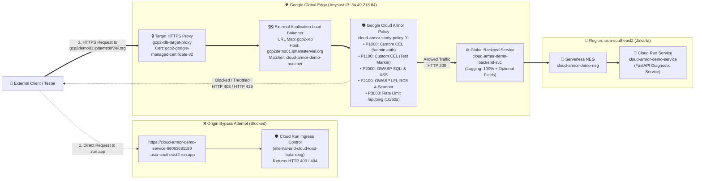

# `cloud-armor-study-01` — Google Cloud Armor Defensive Security Study Repository

This repository provides a complete, hands-on study and live verification environment for **Google Cloud Armor** protecting a **Cloud Run** service (`cloud-armor-demo-service` in `asia-southeast2`, configured with `internal-and-cloud-load-balancing` ingress) behind the global **External Application Load Balancer (`gcp2-xlb`)** at **`https://gcp2demo01.iphamsterviel.org`** in GCP project **`gcp-demo-02-307713`** (project number `66063681189`).

For deep-dive architectural explanations, OWASP ModSecurity CRS v3.3 WAF rule concepts, Custom CEL syntax notes, rate-limiting internals, Cloud Logging telemetry inspection, and **Google Cloud Console GUI-first click-by-click steps** (with `gcloud` CLI fallbacks), see **[`study-notes.md`](./study-notes.md)**.

---

## 1. Architecture Overview (Defense-in-Depth at the Global Edge)



### Live GCP Resource Inventory (`gcp-demo-02-307713`)

| Layer | Resource Name | Type / Scope | Role in This Study Demo |
| :--- | :--- | :--- | :--- |
| **Public DNS & Anycast IP** | `gcp2demo01.iphamsterviel.org` $\rightarrow$ `34.49.218.84` | Global Anycast IPv4 (`gcp2-xlb-fr`) | Routes client HTTPS requests to `gcp2-xlb` on TCP/443 (with automatic HTTP $\rightarrow$ HTTPS redirect via `gcp2-xlb-fr-redirect` on TCP/80). |
| **TLS Certificate** | `gcp2-google-managed-certificate-v2` | Google-Managed SSL Certificate (`ACTIVE`) | Terminates TLS 1.3 at the edge for `gcp2demo01.iphamsterviel.org` (alongside pre-existing demo domains `gcp2demo.iphamsterviel.org`, etc.). |
| **URL Map (Load Balancer)** | `gcp2-xlb` (`cloud-armor-demo-matcher`) | Global External Application Load Balancer (`EXTERNAL_MANAGED`) | Routes `Host: gcp2demo01.iphamsterviel.org` to `cloud-armor-demo-backend-svc` while preserving all pre-existing routes (`gcp2demo.iphamsterviel.org` $\rightarrow$ `matcher1` and default backend `private-gcs-bucket-backend-service-01`). |
| **Cloud Armor Security Policy** | `cloud-armor-study-policy-01` | Global Backend Security Policy (`CLOUD_ARMOR`) | Enforces Custom CEL access control, Custom CEL header/query filtering, OWASP ModSecurity CRS v3.3 WAF rules, and per-IP Rate Limiting (`THROTTLE`) at the edge. |
| **Backend Service** | `cloud-armor-demo-backend-svc` | Global Backend Service (`EXTERNAL_MANAGED`, `HTTP`) | Connects `gcp2-xlb` and `cloud-armor-study-policy-01` to the regional Serverless NEG with `1.0` sample rate logging (`INCLUDE_ALL_OPTIONAL`). |
| **Serverless NEG** | `cloud-armor-demo-neg` | Regional Serverless NEG (`asia-southeast2`) | Bridges the global load balancer backend service to the `cloud-armor-demo-service` Cloud Run service in Jakarta (`asia-southeast2`). |
| **Cloud Run Origin** | `cloud-armor-demo-service` | Managed Cloud Run (`asia-southeast2`) | Safe FastAPI diagnostic web service with ingress locked to **`internal-and-cloud-load-balancing`** so callers cannot bypass Cloud Armor via `https://cloud-armor-demo-service-66063681189.asia-southeast2.run.app`. |

---

## 2. Repository Structure

```text
cloud-armor-study-01/
├── README.md                                  # Architecture, quickstart, rule summary & verification results
├── study-notes.md                             # Deep-dive Cloud Armor study guide (GUI-first steps + gcloud CLI)
├── app/                                       # Safe FastAPI diagnostic web service deployed to Cloud Run
│   ├── Dockerfile                             # Python 3.12-slim container image definition
│   ├── main.py                                # Diagnostic endpoints (/, /healthz, /admin/diagnostics, /api/inspect, /api/ping)
│   └── requirements.txt                       # FastAPI & Uvicorn dependencies
├── cfg/                                       # Exported live declarative YAML configurations from gcp-demo-02-307713
│   ├── cloud-armor-study-policy-01.yaml       # Complete Cloud Armor security policy & rule definitions
│   ├── cloud-armor-demo-backend-svc.yaml      # Global Backend Service configuration with Cloud Armor binding
│   └── gcp2-xlb-url-map.yaml                  # External Application Load Balancer URL map showing preserved routes
├── scripts/                                   # Verification, policy toggle, and cleanup automation scripts
│   ├── env.sh                                 # Central environment variables (project, region, service, domain, policy)
│   ├── verify_security.sh                     # Safe non-weaponized test suite (--mode pre-armor | --mode post-armor)
│   ├── toggle_armor.sh                        # One-command helper to attach, detach, or check Cloud Armor policy status
│   └── cleanup_resources.sh                   # Safe reverse-dependency cleanup (--policy-only | --all)
└── logs/                                      # Captured verbatim outputs from live GCP verification runs
    ├── pre_armor_verification.txt             # Baseline output BEFORE attaching Cloud Armor (endpoints exposed/unthrottled)
    ├── post_armor_verification.txt            # Enforced output AFTER attaching Cloud Armor (403 Forbidden & 429 Too Many Requests)
    └── cloud_armor_sample_logs.json           # Captured Cloud Logging LoadBalancerLogEntry JSON records for each rule priority
```

---

## 3. Interactive Web Browser Study Portal & Cloud Armor Rule Mapping

Open **`https://gcp2demo01.iphamsterviel.org/`** in your Web Browser to access the **Interactive Vulnerability & WAF Verification Portal** ([`app/main.py`](./app/main.py)). It provides 5 interactive study tabs (plus one-click preset buttons and live SQL query previews) so you can test vulnerabilities directly from your browser both **before** and **after** attaching Google Cloud Armor:

| Browser Tab / Endpoint | Purpose in Study Demo | Pre-Armor Behavior (Policy Detached) | Post-Armor Behavior (`cloud-armor-study-policy-01` Attached) | Enforcing Cloud Armor Rule |
| :--- | :--- | :--- | :--- | :--- |
| `GET /` (via `.run.app` URL) | Tests **Origin Bypass Prevention** (`--ingress=internal-and-cloud-load-balancing`) | **Blocked (`HTTP 403` / `HTTP 404`)** by Cloud Run ingress control | **Blocked (`HTTP 403` / `HTTP 404`)** by Cloud Run ingress control | Cloud Run Ingress (`internal-and-cloud-load-balancing`) |
| `GET /` (via `gcp2demo01.iphamsterviel.org`) | **Interactive Web Browser Study Portal** (HTML UI with 5 tabs; returns JSON if `Accept: application/json`) | **Allowed (`HTTP 200 OK`)** | **Allowed (`HTTP 200 OK`)** | **Priority `2147483647`** (Default `allow`) |
| **Tab 1: Login Portal (`POST /login` $\rightarrow$ `/portal/dashboard`)** | **SQL Injection Auth Bypass**: Login form backed by an in-memory SQLite `study_users` table (`username` & `password` inputs) | ⚠️ **VULNERABLE (`HTTP 200 OK`)** — Entering `admin' OR '1'='1` or `admin' --` bypasses password check and **enters the Next Page (`/portal/dashboard`) as `admin`**! | 🛡️ **Both SQLi Presets Blocked at Edge (`HTTP 403 Forbidden`)** while valid credentials (`demo_user` / `CloudArmor2026!`) still enter `/portal/dashboard` (`HTTP 200 OK`)! | **Priority `2000` (OWASP WAF):**<br>`evaluatePreconfiguredWaf('sqli-v33-stable', {'sensitivity': 3})` |
| **Tab 2: Search Wall (`GET /search?q=...`)** | **Reflected XSS Filter Test**: Search input testing script/event-handler payloads (`<script>alert(1)</script>`) | ⚠️ **UNFILTERED (`HTTP 200 OK`)** — XSS vector reaches origin and opens `/search` | 🛡️ **Blocked at Edge (`HTTP 403 Forbidden`)** | **Priority `2000` (OWASP WAF):**<br>`evaluatePreconfiguredWaf('xss-v33-stable', {'sensitivity': 2})` |
| **Tab 3: File & Ping Viewer (`GET /viewer?doc=...&target=...`)** | **LFI & RCE WAF Filter Test**: Tests path traversal (`../../../../etc/passwd`) and command chaining (`8.8.8.8; cat /etc/passwd`) | ⚠️ **UNFILTERED (`HTTP 200 OK`)** — reaches origin and displays simulated exposure | 🛡️ **Blocked at Edge (`HTTP 403 Forbidden`)** | **Priority `2100` (OWASP WAF):**<br>`lfi-v33-stable`, `rce-v33-stable`, `scannerdetection-v33-stable` (`sensitivity: 2`) |
| **Tab 4: Admin & Custom CEL (`GET /admin/diagnostics` & `/api/inspect`)** | **Custom CEL Access Control & Marker Filtering** | ⚠️ **EXPOSED / UNFILTERED (`HTTP 200 OK`)** | 🛡️ **Blocked at Edge (`HTTP 403 Forbidden`)** unless valid `X-Admin-Token: study-secret-2026` is supplied | **Priority `1000` & `1100` (Custom CEL)** |
| **Tab 5: Rate-Limit Burst Simulator (`GET /api/ping`)** | **Interactive 18-Request Visual Burst Grid** in the browser | ⚠️ **UNTHROTTLED (`18/18` tiles turn green `HTTP 200 OK`)** | 🛡️ **Throttled at Edge (First 10 tiles `HTTP 200 OK`, tiles 11–18 turn red `HTTP 429 Too Many Requests`)** | **Priority `3000` (Rate Limit `throttle`):**<br>`10` req / `60s` per `IP` $\rightarrow$ `deny(429)` |
| **Tab 6: Internal VPC Tester (`/vpc-test`, `/api/vpc/ping`, `/api/vpc/curl`, `/api/vpc/network-info`)** | **Outbound Internal VPC Connectivity Workbench** (`ping` + 3x TCP Handshake Latency Probe + `curl` from Cloud Run to internal VPC GCE IPs e.g. `10.2.2.42`) | **Allowed (`HTTP 200 OK`)** | **Allowed (`HTTP 200 OK`)** for valid private VPC IPs/URLs (blocks RCE command injection in `host` via Priority `2100`) | **Priority `2147483647`** (Default `allow`) + **Priority `2100`** (`rce-v33-stable`) |

---

## 4. Quick Reproduction & Verification Guide (GUI-First + `gcloud` CLI)

> **Full Step-by-Step GUI Walkthrough:** Every step below is documented with detailed click-by-click **Google Cloud Console UI instructions** in **[`study-notes.md` Sections 3, 5, 7, and 8](./study-notes.md)**.

### 4.1 Run the Verification Suite Against the Live Environment

Clone this repository and load the environment variables:
```bash
git clone https://github.com/indrapn00/cloud-armor-study-01.git
cd cloud-armor-study-01
source scripts/env.sh
```

Because `cloud-armor-study-policy-01` is left **attached and enforced** on `cloud-armor-demo-backend-svc` (`gcp2-xlb`) as the final live state, you can immediately verify post-Armor enforcement:
```bash
./scripts/verify_security.sh --mode post-armor
```

### 4.2 Toggle Between Pre-Armor (Unprotected) and Post-Armor (Protected)

#### Option A: Via Google Cloud Console GUI (Recommended)
1. Open the Google Cloud Console and go to **Network Security $\rightarrow$ Cloud Armor $\rightarrow$ Policies** (`https://console.cloud.google.com/net-security/securitypolicies/list?project=gcp-demo-02-307713`).
2. Click **`cloud-armor-study-policy-01`** and switch to the **Targets** tab.
3. **To test Pre-Armor (unprotected):** Click the trash/delete icon (or **Remove**) next to **`cloud-armor-demo-backend-svc`**, confirm removal, wait ~60 seconds for edge propagation, and run:
   ```bash
   ./scripts/verify_security.sh --mode pre-armor
   ```
4. **To re-attach Post-Armor (protected):** On the **Targets** tab of `cloud-armor-study-policy-01`, click **Apply policy to new target**, select ** Type: `Load balancer backend service`**, choose **`cloud-armor-demo-backend-svc`**, click **Add**, wait ~60 seconds, and run:
   ```bash
   ./scripts/verify_security.sh --mode post-armor
   ```

#### Option B: Via Helper Script / `gcloud` CLI
```bash
# Check current attachment status
./scripts/toggle_armor.sh status

# Detach Cloud Armor policy (to observe Pre-Armor baseline behavior)
./scripts/toggle_armor.sh detach
# Wait ~60s, then run:
./scripts/verify_security.sh --mode pre-armor

# Re-attach Cloud Armor policy (to restore Post-Armor enforcement)
./scripts/toggle_armor.sh attach
# Wait ~60s, then run:
./scripts/verify_security.sh --mode post-armor
```

---

## 5. Summary of Captured Pre-Armor vs. Post-Armor Verification Results

Full verbatim terminal outputs are saved in **[`logs/pre_armor_verification.txt`](./logs/pre_armor_verification.txt)** and **[`logs/post_armor_verification.txt`](./logs/post_armor_verification.txt)**, and sample Cloud Logging JSON entries are saved in **[`logs/cloud_armor_sample_logs.json`](./logs/cloud_armor_sample_logs.json)**.

| Test ID | Test Case & Request | Pre-Armor Result ([`logs/pre_armor_verification.txt`](./logs/pre_armor_verification.txt)) | Post-Armor Result ([`logs/post_armor_verification.txt`](./logs/post_armor_verification.txt)) | Cloud Logging `enforcedSecurityPolicy` Outcome |
| :--- | :--- | :--- | :--- | :--- |
| **TEST 1** | Direct `.run.app` URL (`https://cloud-armor-demo-service-66063681189.asia-southeast2.run.app/`) | **`HTTP 404` / `HTTP 403`** *(Blocked by Cloud Run ingress)* | **`HTTP 404` / `HTTP 403`** *(Blocked by Cloud Run ingress)* | Blocked prior to Cloud Run container (`internal-and-cloud-load-balancing`) |
| **TEST 2** | Baseline `GET https://gcp2demo01.iphamsterviel.org/` | **`HTTP 200 OK`** | **`HTTP 200 OK`** | `priority: 2147483647`, `configuredAction: "ALLOW"`, `outcome: "ACCEPT"` |
| **TEST 3** | Unprotected Admin `GET https://gcp2demo01.iphamsterviel.org/admin/diagnostics` *(no header)* | ⚠️ **`HTTP 200 OK`** *(`EXPOSED_WITHOUT_CLOUD_ARMOR`)* | 🛡️ **`HTTP 403 Forbidden`** *(Blocked at XLB edge)* | `priority: 1000`, `configuredAction: "DENY"`, `outcome: "DENY"` |
| **TEST 4** | Authorized Admin `GET https://gcp2demo01.iphamsterviel.org/admin/diagnostics` + `X-Admin-Token: study-secret-2026` | **`HTTP 200 OK`** *(`AUTHORIZED`)* | ✅ **`HTTP 200 OK`** *(`AUTHORIZED`)* | `priority: 2147483647`, `configuredAction: "ALLOW"`, `outcome: "ACCEPT"` |
| **TEST 5A** | Header Marker `GET https://gcp2demo01.iphamsterviel.org/api/inspect` + `X-Policy-Test: block-me` | ⚠️ **`HTTP 200 OK`** *(`UNFILTERED_AT_EDGE`)* | 🛡️ **`HTTP 403 Forbidden`** *(Blocked at XLB edge)* | `priority: 1100`, `configuredAction: "DENY"`, `outcome: "DENY"` |
| **TEST 5B** | Query Marker `GET https://gcp2demo01.iphamsterviel.org/api/inspect?policy_test=block` | ⚠️ **`HTTP 200 OK`** *(`UNFILTERED_AT_EDGE`)* | 🛡️ **`HTTP 403 Forbidden`** *(Blocked at XLB edge)* | `priority: 1100`, `configuredAction: "DENY"`, `outcome: "DENY"` |
| **TEST 6** | Burst Rate Limit (`18` rapid requests to `GET https://gcp2demo01.iphamsterviel.org/api/ping`) | ⚠️ **`18/18` returned `HTTP 200 OK`** *(`0` throttled)* | 🛡️ **Conforming requests return `HTTP 200 OK`; excess requests return `HTTP 429 Too Many Requests`** | `priority: 3000`, `configuredAction: "THROTTLE"`, `rateLimitAction.outcome: "RATE_LIMIT_THRESHOLD_EXCEED"` (`DENY` 429) |

---

## 6. Cleanup Instructions (GUI-First + CLI)

> **Important:** Live resources are currently left **active and enforced** in `gcp-demo-02-307713` for review. If you later wish to clean up this study demo while keeping `gcp2-xlb` and all other demos untouched, see **[`study-notes.md` Section 8](./study-notes.md)** for step-by-step **Google Cloud Console UI deletion instructions**, or run:
> ```bash
> # Remove only the Cloud Armor policy (keep Cloud Run + XLB route alive)
> ./scripts/cleanup_resources.sh --policy-only
>
> # Or remove all demo resources (dynamically discovers GUI/CLI path matcher on gcp2-xlb, then deletes backend service, NEG, and Cloud Run)
> ./scripts/cleanup_resources.sh --all
>
> # Re-deploy the entire study environment from scratch in one command:
> ./scripts/deploy_all.sh
> ```
