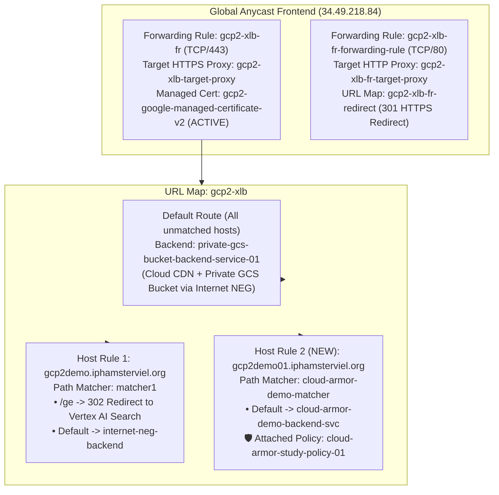
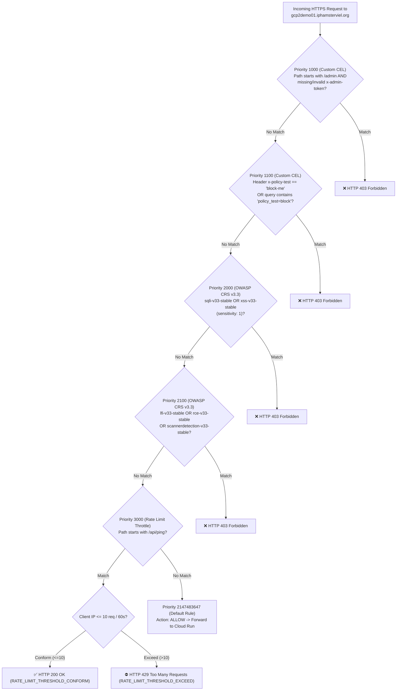

# Google Cloud Armor — Study Notes (`cloud-armor-study-01`)

> **Author / Context:** Study notes for a Google Cloud CE Networking Specialist (`indrapn`) building a complete Layer-7 edge defense demo with **Cloud Run** (`asia-southeast2`, restricted ingress), **Global External Application Load Balancing (`gcp2-xlb`)**, and **Google Cloud Armor (`cloud-armor-study-policy-01`)** in Argolis project **`gcp-demo-02-307713`** (project number `66063681189`, Organization `304553879287`).

---

## 1. Problem Statement: Why Do We Need Defense-in-Depth at the Edge?

When you deploy a containerized web application or API to **Cloud Run**, it automatically receives a public `*.run.app` URL backed by Google Frontend (GFE). However, exposing a Cloud Run service directly to the internet—or placing it behind an External Application Load Balancer **without** Google Cloud Armor—leaves four major security gaps:

| # | Gap Without Cloud Armor + Ingress Lock | Networking Analogy | How Our Architecture Solves It |
| :--- | :--- | :--- | :--- |
| **1** | **Origin Bypass via Default `.run.app` URL** | Putting a Next-Gen Firewall in front of a web server, but leaving a second public IP NATed directly to the server's NIC. Attackers simply bypass the firewall and hit `.run.app` directly. | **Cloud Run Ingress Restricted to `internal-and-cloud-load-balancing`**. Direct internet requests to `https://cloud-armor-demo-service-66063681189.asia-southeast2.run.app` are rejected at the GFE before reaching the container (`HTTP 403` from external IPs / `HTTP 404` on internal GFE routing), forcing 100% of external traffic through `gcp2-xlb`. |
| **2** | **Accidental Exposure of Internal / Debug Routes (`/admin/diagnostics`)** | Publishing an entire internal subnet without ACLs on management ports (`:8080/admin`, `/metrics`, `/debug`). | **Cloud Armor Custom CEL Rule (`Priority 1000`)**. Evaluates Layer-7 path and headers at Google's global edge (`request.path.startsWith('/admin') && (!has(request.headers['x-admin-token']) \|\| request.headers['x-admin-token'] != 'study-secret-2026')`) and drops unauthorized requests with `HTTP 403 Forbidden` before they ever traverse the backbone to `asia-southeast2`. |
| **3** | **Uninspected Layer-7 Payloads, Headers & Query Strings** | Using a stateless L3/L4 packet filter with no Intrusion Prevention System (IPS) or Web Application Firewall (WAF) payload inspection. | **Preconfigured OWASP ModSecurity CRS v3.3 WAF Rules (`Priority 2000 & 2100`) + Custom CEL Marker Filtering (`Priority 1100`)**. Inspects headers, cookies, query strings, and POST bodies (including JSON via `jsonParsing: STANDARD`) at the edge. |
| **4** | **Unthrottled Volumetric Bursts & API Scraping (`/api/ping`)** | Having no QoS policer on an ingress interface—a single client IP can flood the backend and force Cloud Run autoscaling cost spikes or resource exhaustion. | **Cloud Armor Rate Limiting (`Priority 3000`, `action: throttle`)**. Enforces a per-client-IP quota (`10` requests per `60` seconds on `/api/ping`), allowing conforming traffic (`HTTP 200`) and shedding excess burst traffic at the edge with **`HTTP 429 Too Many Requests`**. |

---

## 2. Inspecting the Existing `gcp2-xlb` Load Balancer, DNS & TLS Setup

Before adding any new routes, we inspected how **`gcp2-xlb`** is architected in project `gcp-demo-02-307713` so that our new Cloud Run backend coexists cleanly with all pre-existing demos:



### Key Pre-Existing Infrastructure Findings
1. **Public DNS (`gcp2demo01.iphamsterviel.org`):** Already resolves in public DNS to **`34.49.218.84`**, which is the global Anycast IP of forwarding rule `gcp2-xlb-fr`.
2. **Google-Managed TLS Certificate (`gcp2-google-managed-certificate-v2`):** Attached to `gcp2-xlb-target-proxy` in status `ACTIVE`, with Subject Alternative Names (SANs) already provisioned for `gcp2demo.iphamsterviel.org` as well as **`gcp2demo01.iphamsterviel.org`** through `gcp2demo05.iphamsterviel.org`.
3. **Why Unmatched Requests to `gcp2demo01.iphamsterviel.org` Previously Returned XML (`ListBucketResult`):** Before we added a Host Rule for `gcp2demo01.iphamsterviel.org`, requests to `https://gcp2demo01.iphamsterviel.org/` fell through to the URL map's catch-all `defaultService` (`private-gcs-bucket-backend-service-01`), which rewrote the `Host` header to `gcp2-private-gcs-demo-01.storage.googleapis.com` and returned a GCS bucket XML listing. Adding the dedicated Host Rule (`gcp2demo01.iphamsterviel.org` $\rightarrow$ `cloud-armor-demo-matcher` $\rightarrow$ `cloud-armor-demo-backend-svc`) cleanly isolates our study traffic without touching `private-gcs-bucket-backend-service-01` or `matcher1`.

---

## 3. Step-by-Step Build Guide from Scratch (Google Cloud Console GUI Primary + `gcloud` CLI)

> [!TIP]
> **GUI-First Approach:** In every section below, **Option A** gives you the exact click-by-click steps in the **Google Cloud Console UI**, while **Option B** provides the equivalent **`gcloud` CLI** commands.

### 3.1 Deploy the Safe Diagnostic Web Service to Cloud Run (`asia-southeast2`)

Our application source code lives in **[`app/main.py`](./app/main.py)**, **[`app/requirements.txt`](./app/requirements.txt)**, and **[`app/Dockerfile`](./app/Dockerfile)**.

#### Option A: Via Google Cloud Console GUI
1. Open the Google Cloud Console and navigate to **Cloud Run** (`https://console.cloud.google.com/run?project=gcp-demo-02-307713`).
2. Click **Deploy container $\rightarrow$ Service** (or **Create service**).
3. **Source selection:**
   - Choose **Continuously deploy from a repository** (connecting `https://github.com/indrapn00/cloud-armor-study-01` with build context `/app/Dockerfile`), **OR** upload/deploy from source directory `app/`.
4. **Service name & Region:**
   - **Service name:** `cloud-armor-demo-service`
   - **Region:** `asia-southeast2 (Jakarta)`
5. **Authentication:**
   - Select **Allow unauthenticated invocations** (because public web clients connect without a Google IAM Bearer token; access control is enforced at the network/L7 edge by Load Balancing + Cloud Armor).
6. **Ingress control (Critical for Origin Bypass Prevention):**
   - Under **Ingress**, select **Internal** and check the box **Allow traffic from external Application Load Balancers** (this corresponds to `internal-and-cloud-load-balancing`).
7. **Container, Networking, Security:**
   - **Container port:** `8080`
   - **Minimum number of instances:** `1` (keeps 1 warm instance for instant study testing)
   - **Maximum number of instances:** `5`
8. Click **Create** and wait ~45 seconds for the revision (`cloud-armor-demo-service-00001-jfz`) to turn green.

#### Option B: Via `gcloud` CLI
```bash
gcloud run deploy cloud-armor-demo-service \
  --source=/usr/local/google/home/indrapn/my_agy/cloud-armor-study-01/app \
  --region=asia-southeast2 \
  --project=gcp-demo-02-307713 \
  --allow-unauthenticated \
  --ingress=internal-and-cloud-load-balancing \
  --min-instances=1 \
  --max-instances=5 \
  --quiet
```

---

### 3.2 Configure Serverless NEG, Backend Service & Host Routing on `gcp2-xlb`

#### Option A: Via Google Cloud Console GUI
1. Navigate to **Network Services $\rightarrow$ Load balancing** (`https://console.cloud.google.com/net-services/loadbalancing/list/loadBalancers?project=gcp-demo-02-307713`).
2. Click **`gcp2-xlb`** and click **Edit** at the top of the page.
3. **Step 1 — Create the Backend Service & Serverless NEG:**
   - Click **Backend configuration** on the left wizard pane.
   - Open the **Backend services & backend buckets** dropdown and click **Create a backend service**.
   - **Name:** `cloud-armor-demo-backend-svc`
   - **Backend type:** Select **`Serverless network endpoint group`**.
   - *(Note: When you select `Serverless network endpoint group` in the UI, the Console automatically omits `portName` so you avoid the `portName is not supported` API error.)*
   - Under **Backends $\rightarrow$ New backend**, open the **Serverless network endpoint groups** dropdown and click **Create serverless network endpoint group**:
     - **Name:** `cloud-armor-demo-neg`
     - **Region:** `asia-southeast2`
     - **Serverless network endpoint group type:** `Cloud Run`
     - **Select service:** `cloud-armor-demo-service`
     - Click **Create**.
   - **Cloud CDN:** Leave **Unchecked** (disabled) so every request is evaluated directly by our backend security policy and Cloud Run origin.
   - **Cloud Armor backend security policy:** Select **`None`** for now (so we can run our Pre-Armor baseline verification first!).
   - **Logging:** Check **Enable logging**, set **Sample rate** to `1`, and set **Optional fields** to **`Include all optional fields`**.
   - Click **Create** to save `cloud-armor-demo-backend-svc`.
4. **Step 2 — Add the Host and Path Rule (Preserving Existing Routes):**
   - Click **Routing rules** on the left wizard pane.
   - Leave the existing rules (`All unmatched (default)` $\rightarrow$ `private-gcs-bucket-backend-service-01` and `gcp2demo.iphamsterviel.org` $\rightarrow$ `matcher1`) **completely untouched**.
   - Click **+ Add host and path rule**:
     - **Hosts:** `gcp2demo01.iphamsterviel.org`
     - **Path matcher (Select service):** Select **`cloud-armor-demo-backend-svc`** (or in Advanced host and path rule mode, name the path matcher `cloud-armor-demo-matcher` with default service `cloud-armor-demo-backend-svc`).
5. Click **Update** at the bottom of the Load Balancer editor and wait ~60 seconds for global GFE propagation.

#### Option B: Via `gcloud` CLI
```bash
# 1. Create the regional Serverless NEG in asia-southeast2
gcloud compute network-endpoint-groups create cloud-armor-demo-neg \
  --region=asia-southeast2 \
  --network-endpoint-type=serverless \
  --cloud-run-service=cloud-armor-demo-service \
  --project=gcp-demo-02-307713

# 2. Create the global Backend Service (IMPORTANT: do NOT pass --protocol=HTTPS,
#    because gcloud auto-populates portName=https which Serverless NEGs reject!)
gcloud compute backend-services create cloud-armor-demo-backend-svc \
  --load-balancing-scheme=EXTERNAL_MANAGED \
  --enable-logging \
  --logging-sample-rate=1.0 \
  --logging-optional=INCLUDE_ALL_OPTIONAL \
  --global \
  --project=gcp-demo-02-307713

# 3. Attach the Serverless NEG to the Backend Service
gcloud compute backend-services add-backend cloud-armor-demo-backend-svc \
  --global \
  --network-endpoint-group=cloud-armor-demo-neg \
  --network-endpoint-group-region=asia-southeast2 \
  --project=gcp-demo-02-307713

# 4. Add the Host & Path Matcher for gcp2demo01.iphamsterviel.org to gcp2-xlb
gcloud compute url-maps add-path-matcher gcp2-xlb \
  --path-matcher-name=cloud-armor-demo-matcher \
  --default-service=cloud-armor-demo-backend-svc \
  --new-hosts=gcp2demo01.iphamsterviel.org \
  --global \
  --project=gcp-demo-02-307713
```

> [!WARNING]
> **Gotcha Discovered During Setup (`portName` on Serverless NEG Backend Services):**
> If you run `gcloud compute backend-services create ... --protocol=HTTPS`, `gcloud` prints:
> `Backend-services' port_name automatically resolved to https based on the service protocol.`
> When you subsequently run `gcloud compute backend-services add-backend` with a Serverless NEG, the Compute Engine API rejects it with:
> `Invalid value for field 'resource.portName': 'https'. Port name is not supported for a backend service with Serverless network endpoint groups.`
> **Fix:** Omit `--protocol=HTTPS` when creating a backend service for a Serverless NEG (the load balancer still communicates securely over Google's internal fabric to Cloud Run).

---

## 4. Baseline (Pre-Armor) Verification & Captured Output

Before attaching Cloud Armor to `cloud-armor-demo-backend-svc`, we ran our safe verification script (`./scripts/verify_security.sh --mode pre-armor`).

### Why `TEST 1` (Direct `.run.app` URL) Returns `HTTP 403` vs `HTTP 404` Depending on Caller Network
When `--ingress=internal-and-cloud-load-balancing` is configured on Cloud Run:
- **From an external internet host** (hitting the public GFE VIP `34.143.76.2`), Google Frontend returns **`HTTP 403 Forbidden`** (`Error: Page Forbidden - Your client does not have permission to get URL / from this server`).
- **From a Google Cloudtop workstation** (which routes `*.run.app` via internal Google production routing), the internal GFE does not publish the external route when ingress is restricted and returns **`HTTP 404 Not Found`**.
- **From a GCE VM inside the same project (`openvpn-vm-01` in `gcp-demo-02-307713`)**, Cloud Run allows the request (`HTTP 200`) because `internal-and-cloud-load-balancing` permits traffic from VPC networks in the same project!
- When we temporarily toggled `--ingress=all` during testing, `https://cloud-armor-demo-service-66063681189.asia-southeast2.run.app/` immediately returned `HTTP 200`, and restoring `--ingress=internal-and-cloud-load-balancing` immediately blocked direct access again.

### Verbatim Captured Pre-Armor Output ([`logs/pre_armor_verification.txt`](./logs/pre_armor_verification.txt))

```text
================================================================================
 Google Cloud Armor Defensive Study Verification Suite
 Mode                 : pre-armor
 Timestamp (UTC)      : 2026-10-22T04:27:14Z
 GCP Project          : gcp-demo-02-307713
 Cloud Run Direct URL : https://cloud-armor-demo-service-66063681189.asia-southeast2.run.app
 XLB Public Endpoint  : https://gcp2demo01.iphamsterviel.org (34.49.218.84)
 Security Policy      : cloud-armor-study-policy-01
================================================================================

--------------------------------------------------------------------------------
[TEST 1] Direct Cloud Run Default URL (https://cloud-armor-demo-service-66063681189.asia-southeast2.run.app/)
  Expected (pre-armor) : HTTP 403/404 (Blocked by Cloud Run internal-and-cloud-load-balancing ingress; GFE returns 404 on internal-route Cloudtop)
  Actual HTTP Status : HTTP 404
  Response Preview   :  <html><head> <meta http-equiv="content-type" content="text/html;charset=utf-8"> <title>404 Not Found</title> </head> <body text=#000000 bgcolor=#ffffff> <h1>Error: Not Found</h1> <h2>The requested URL <code>/</code> was not found on this server.</h2> <h2></h2

--------------------------------------------------------------------------------
[TEST 2] Baseline Public Endpoint (GET https://gcp2demo01.iphamsterviel.org/)
  Expected (pre-armor) : HTTP 200 (Allowed via gcp2-xlb)
  Actual HTTP Status : HTTP 200
  Response Preview   : {"service":"cloud-armor-demo-service","revision":"cloud-armor-demo-service-00001-jfz","project":"gcp-demo-02-307713","region":"asia-southeast2","status":"ok","timestamp_utc":"2026-10-22T04:27:14.987285+00:00","message":"Baseline request succeeded through Exter

--------------------------------------------------------------------------------
[TEST 3] Admin Diagnostics WITHOUT Auth Header (GET https://gcp2demo01.iphamsterviel.org/admin/diagnostics)
  Expected (pre-armor) : HTTP 200 (EXPOSED! Unprotected admin endpoint without Cloud Armor)
  Actual HTTP Status : HTTP 200
  Response Preview   : {"endpoint":"/admin/diagnostics","service":"cloud-armor-demo-service","revision":"cloud-armor-demo-service-00001-jfz","timestamp_utc":"2026-10-22T04:27:15.100977+00:00","admin_token_present":false,"admin_token_valid":false,"security_observation":"EXPOSED_WITHO

--------------------------------------------------------------------------------
[TEST 4] Admin Diagnostics WITH Valid X-Admin-Token Header (GET https://gcp2demo01.iphamsterviel.org/admin/diagnostics)
  Expected (pre-armor) : HTTP 200 (Allowed with X-Admin-Token header)
  Actual HTTP Status : HTTP 200
  Response Preview   : {"endpoint":"/admin/diagnostics","service":"cloud-armor-demo-service","revision":"cloud-armor-demo-service-00001-jfz","timestamp_utc":"2026-10-22T04:27:15.220645+00:00","admin_token_present":true,"admin_token_valid":true,"security_observation":"AUTHORIZED: Val

--------------------------------------------------------------------------------
[TEST 5A] Inspect Endpoint WITH Benign Test Header 'X-Policy-Test: block-me'
  Expected (pre-armor) : HTTP 200 (UNFILTERED! Marker header X-Policy-Test: block-me reaches origin)
  Actual HTTP Status : HTTP 200
  Response Preview   : {"endpoint":"/api/inspect","service":"cloud-armor-demo-service","timestamp_utc":"2026-10-22T04:27:15.290472+00:00","policy_marker_detected_at_origin":true,"security_observation":"UNFILTERED_AT_EDGE: Request carrying policy test marker reached the Cloud Run ori

--------------------------------------------------------------------------------
[TEST 5B] Inspect Endpoint WITH Benign Test Query '?policy_test=block'
  Expected (pre-armor) : HTTP 200 (UNFILTERED! Query ?policy_test=block reaches origin)
  Actual HTTP Status : HTTP 200
  Response Preview   : {"endpoint":"/api/inspect","service":"cloud-armor-demo-service","timestamp_utc":"2026-10-22T04:27:15.367040+00:00","policy_marker_detected_at_origin":true,"security_observation":"UNFILTERED_AT_EDGE: Request carrying policy test marker reached the Cloud Run ori

--------------------------------------------------------------------------------
[TEST 6] Rapid Burst Rate-Limit Check (18 requests to https://gcp2demo01.iphamsterviel.org/api/ping)
  Expected (pre-armor) : All 18/18 requests return HTTP 200 (UNTHROTTLED!)
  Status Sequence    : 200 200 200 200 200 200 200 200 200 200 200 200 200 200 200 200 200 200
  Burst Summary      : HTTP 200 = 18/18 | Throttled (HTTP 429) = 0/18 | Other = 0/18
================================================================================
```

### 4.3 Interactive Web Browser Walkthrough (`https://gcp2demo01.iphamsterviel.org/`)

In addition to CLI checks, our Cloud Run application serves an interactive **Web Browser Study Lab** at **`https://gcp2demo01.iphamsterviel.org/`** with 5 tabs so you can test vulnerabilities directly from your browser and watch how the page transitions work **before** and **after** attaching Cloud Armor:

1. **Tab 1 — Login Portal (`SQLi Auth Bypass` $\rightarrow$ Enters Next Page `/portal/dashboard`):**
   - Contains **Username** and **Password** inputs backed by an ephemeral in-memory SQLite table (`study_users`) and a live SQL query preview box:
     ```sql
     SELECT id, username, role, clearance, vault_note
     FROM study_users
     WHERE username = '<username>' AND password = '<password>';
     ```
   - **Test 1 (Valid Login — Works Both Pre-Armor & Post-Armor):**
     - Click **`✅ Fill Valid User`** (`demo_user` / `CloudArmor2026!`) and click **`Sign In & Enter Next Page (/portal/dashboard) →`**.
     - Your browser navigates to the **Executive Vault Next Page** displaying a green banner (`✅ LEGITIMATE SIGN-IN SUCCEEDED`) and your `demo_user` session record.
   - **Test 2 (SQL Injection Login Bypass — Pre-Armor vs. Post-Armor):**
     - Click **`🔓 Fill SQLi Auth Bypass: admin' OR '1'='1`** (or **`🔓 Fill SQLi Comment Bypass: admin' --`**).
     - **When Cloud Armor is Detached (Pre-Armor):** Clicking **`Sign In & Enter Next Page (/portal/dashboard) →`** executes the tautology query (`WHERE username = 'admin' OR '1'='1' AND password = '...'`), bypasses authentication without knowing `admin`'s password, and **opens the Next Page (`/portal/dashboard`)** as `admin` (`LEVEL_5_EXECUTIVE_VAULT`), exposing all 4 internal user records!
     - **When Cloud Armor is Attached (Post-Armor):** Clicking **`Sign In & Enter Next Page`** (or **`Test Inline`**) with `admin' OR '1'='1` is immediately intercepted at the `gcp2-xlb` load balancer edge by **Cloud Armor Priority `2000` (`sqli-v33-stable`)** and blocked with **`HTTP 403 Forbidden`** before the request ever reaches Cloud Run!
2. **Tab 2 — Search & Feedback Wall (`OWASP XSS WAF Filter` $\rightarrow$ `/search`):**
   - Click **`🔓 Fill Reflected Script Vector (<script>...)`** and submit.
   - **Pre-Armor:** Opens `/search` showing the unfiltered XSS detection alert.
   - **Post-Armor:** Blocked at the edge by **Priority `2000` (`xss-v33-stable`)** with **`HTTP 403 Forbidden`**.
3. **Tab 3 — File & Ping Utility (`OWASP LFI & RCE WAF Filter` $\rightarrow$ `/viewer`):**
   - Click **`🔓 Fill LFI Path Traversal (../../../../etc/passwd)`** or **`🔓 Fill RCE Command Chaining (8.8.8.8; cat /etc/passwd)`** and submit.
   - **Pre-Armor:** Opens `/viewer` showing simulated file exposure.
   - **Post-Armor:** Blocked at the edge by **Priority `2100` (`lfi-v33-stable` / `rce-v33-stable`)** with **`HTTP 403 Forbidden`**.
4. **Tab 4 — Admin Diagnostics & Custom CEL Rules (`Priority 1000 & 1100`):**
   - One-click browser buttons that call `/admin/diagnostics` (without and with `X-Admin-Token: study-secret-2026`) and `/api/inspect` (with `X-Policy-Test: block-me` and `?policy_test=block`) and display the HTTP status and payload right on the page.
5. **Tab 5 — Interactive Rate-Limiting Burst Simulator (`Priority 3000`):**
   - Click **`⚡ Fire 18 Rapid Requests to /api/ping`** to watch 18 visual request tiles update live in your browser: in Post-Armor mode, the first 10 tiles turn **green (`HTTP 200 OK`)** and tiles 11–18 turn **red (`HTTP 429 Too Many Requests`)**!

---

## 5. Deep Dive into Google Cloud Armor Rules (Concepts + GUI & CLI Configuration)

Google Cloud Armor evaluates rules in **ascending numerical priority order** (`0` is evaluated first; `2,147,483,647` is the catch-all default rule evaluated last). The **first rule that matches** a request determines the action (`ALLOW`, `DENY`, `THROTTLE`, `RATE_BASED_BAN`, or `REDIRECT`).



### 5.1 Preconfigured OWASP ModSecurity Core Rule Set (CRS v3.3) WAF Rules (`Priority 2000 & 2100`)

Cloud Armor includes built-in **OWASP ModSecurity Core Rule Set (CRS) v3.3** rule sets invoked via the CEL function `evaluatePreconfiguredWaf('<rule_set>', {'sensitivity': <1..4>})`:

| Preconfigured WAF Rule Set | Rule Priority in Our Policy | What It Inspects & Protects Against | How Sensitivity Levels (`1`–`4`) Work |
| :--- | :--- | :--- | :--- |
| **`sqli-v33-stable`** *(SQL Injection)* | **Priority `2000`** | Inspects URI query strings, request headers, cookies, and POST bodies (including parsed JSON keys/values when `jsonParsing: STANDARD` is enabled) for SQL syntax manipulation, tautologies, UNION queries, comment injection, and stacked queries aiming to tamper with backend databases. | • **Sensitivity `1` (Low / Paranoia Level 1):** High-confidence signatures with minimal false positives (recommended baseline).<br>• **Sensitivity `2`–`4` (Paranoia Levels 2–4):** Progressively stricter heuristic patterns (e.g., flagging common punctuation combinations); may require `opt_out_rule_ids` tuning for complex JSON APIs. |
| **`xss-v33-stable`** *(Cross-Site Scripting)* | **Priority `2000`** | Detects script tags, event handlers, DOM manipulation attributes, and encoded JavaScript payloads in parameters, headers, or request bodies designed to execute in a victim's browser. |Sensitivity `1` blocks canonical script/event injection vectors while avoiding false positives on normal prose. |
| **`lfi-v33-stable`** *(Local File Inclusion)* | **Priority `2100`** | Detects directory traversal sequences and OS file path references attempting to read sensitive local filesystem paths (e.g., `/etc/`, `/proc/`, `.env`, or cloud metadata files) from the application container. | Sensitivity `1` catches path traversal and known sensitive OS file targets. |
| **`rce-v33-stable`** *(Remote Code Execution)* | **Priority `2100`** | Detects OS command chaining, shell metacharacters, subshell invocations, and common Unix/Windows binary execution patterns injected into request fields. | Sensitivity `1` blocks direct command/shell injection patterns with low false-positive risk. |
| **`scannerdetection-v33-stable`** *(Scanner Detection)* | **Priority `2100`** | Identifies known automated vulnerability scanners, reconnaissance crawlers, and security enumeration tools based on `User-Agent` strings, custom scanner headers, and probing signatures. | Sensitivity `1` matches known scanner fingerprints before they can enumerate application routes. |

> **Why we enabled `jsonParsing: STANDARD` on `cloud-armor-study-policy-01`:** Modern REST and AI agent APIs send `application/json` POST bodies. Without `jsonParsing: STANDARD`, WAF signatures treat a JSON body as one opaque text blob (which can either miss nested payloads or cause false positives on JSON braces/quotes). With `jsonParsing: STANDARD`, Cloud Armor parses the JSON key-value pairs up to the configured body inspection depth (`8 KB` default, configurable up to `64 KB`) and evaluates WAF rules cleanly against individual values.

---

### 5.2 Custom CEL (Common Expression Language) Rules (`Priority 1000 & 1100`)

In addition to preconfigured WAF signatures, Cloud Armor lets you write custom **CEL expressions** against Layer-7 request attributes (`request.path`, `request.query`, `request.method`, `request.headers`, `origin.ip`, `origin.region_code`, `origin.asn`, `token.recaptcha_action.score`, etc.).

1. **Priority `1000` — Protecting `/admin/diagnostics` at the Edge:**
   ```cel
   request.path.startsWith('/admin') && (!has(request.headers['x-admin-token']) || request.headers['x-admin-token'] != 'study-secret-2026')
   ```
   - **How it works:** Any request whose URL path starts with `/admin` is immediately denied with `HTTP 403` **unless** the request includes the HTTP header `X-Admin-Token: study-secret-2026`.
2. **Priority `1100` — Safe Policy-Verification Marker Rule (`X-Policy-Test` / `policy_test`):**
   ```cel
   (has(request.headers['x-policy-test']) && request.headers['x-policy-test'] == 'block-me') || request.query.contains('policy_test=block')
   ```
   - **How it works:** Allows us to deterministically test L7 header and query string inspection using completely benign, non-weaponized requests (`-H "X-Policy-Test: block-me"` or `?policy_test=block`).

> [!IMPORTANT]
> **Gotcha Discovered with Cloud Armor CEL Map Syntax (`has(request.headers['...'])`):**
> Unlike standard Python/JavaScript or IAM v3 CEL where you might write `'x-admin-token' in request.headers` or `request.headers.contains('x-admin-token')`, Cloud Armor's CEL compiler treats `request.headers` as a `map(string, string)` that **does not** overload `.contains()` or the `in` operator:
> - `request.headers.contains('x-admin-token')` fails with: `found no matching overload for 'contains' applied to 'map(string, string).(string)'`
> - `'x-admin-token' in request.headers` fails with: `undeclared reference to '@in'`
> - **Correct Cloud Armor CEL syntax:** Always use the **`has()` macro** with lowercase header keys:
>   `has(request.headers['x-admin-token']) && request.headers['x-admin-token'] == 'study-secret-2026'`
>   *(Note: `request.query` is a `string`, so `request.query.contains('policy_test=block')` works directly!)*

---

### 5.3 Rate Limiting: `throttle` vs. `rate-based-ban` (`Priority 3000`)

Cloud Armor supports two rate-limiting actions:
- **`throttle` (Used in Priority `3000`):** Tracks request volume per tracking key (`enforceOnKey: IP`) over a rolling window (`10` requests per `60` seconds). As long as the client is $\le 10$ requests/60s, requests conform (`conformAction: allow` $\rightarrow$ `HTTP 200`). Once the client exceeds 10 requests in that window, excess requests are rejected at the edge with **`HTTP 429 Too Many Requests`** (`exceedAction: deny(429)`). As soon as the rolling 60-second window advances, requests from that IP are allowed again.
- **`rate-based-ban`:** Similar to `throttle`, except once the threshold (or an optional secondary `banThreshold`) is breached, the client key is placed in a **penalty box** for `banDurationSec` (e.g., `300` seconds), during which *every* request from that client is denied even if they slow down.

---

### 5.4 Step-by-Step Guide to Create & Attach `cloud-armor-study-policy-01` (GUI Primary + `gcloud` CLI)

#### Option A: Via Google Cloud Console GUI
1. Navigate to **Network Security $\rightarrow$ Cloud Armor $\rightarrow$ Policies** (`https://console.cloud.google.com/net-security/securitypolicies/list?project=gcp-demo-02-307713`).
2. Click **Create policy**:
   - **Name:** `cloud-armor-study-policy-01`
   - **Description:** `Google Cloud Armor Defensive Study Policy (OWASP CRS v3.3 WAF, Custom CEL access/marker rules, and Rate Limiting)`
   - **Policy type:** `Backend security policy`
   - **Scope:** `Global`
   - **Default rule action:** `Allow`
3. Expand **More options (Advanced settings)**:
   - **Content parsing:** Select **`JSON standard`** (`STANDARD`)
   - **Logging:** Select **`Verbose`** (`VERBOSE`)
4. Click **Next step (Add more rules)** and add the 5 rules below by clicking **Add a rule** for each:
   - **Rule 1 (Priority `1000` — Protect `/admin/diagnostics`):**
     - **Condition mode:** Select **`Advanced mode`**
     - **Match:** `request.path.startsWith('/admin') && (!has(request.headers['x-admin-token']) || request.headers['x-admin-token'] != 'study-secret-2026')`
     - **Action:** `Deny` $\rightarrow$ **Response code:** `403 (Forbidden)`
     - **Priority:** `1000`
     - **Description:** `Block unauthorized access to /admin endpoints unless valid X-Admin-Token header is provided`
   - **Rule 2 (Priority `1100` — Block Benign Policy Test Markers):**
     - **Condition mode:** `Advanced mode`
     - **Match:** `(has(request.headers['x-policy-test']) && request.headers['x-policy-test'] == 'block-me') || request.query.contains('policy_test=block')`
     - **Action:** `Deny` $\rightarrow$ **Response code:** `403 (Forbidden)`
     - **Priority:** `1100`
     - **Description:** `Block requests carrying benign policy verification marker in X-Policy-Test header or query parameter`
   - **Rule 3 (Priority `2000` — OWASP CRS SQLi & XSS):**
     - **Condition mode:** `Advanced mode`
     - **Match:** `evaluatePreconfiguredWaf('sqli-v33-stable', {'sensitivity': 1}) || evaluatePreconfiguredWaf('xss-v33-stable', {'sensitivity': 1})`
     - **Action:** `Deny` $\rightarrow$ **Response code:** `403 (Forbidden)`
     - **Priority:** `2000`
     - **Description:** `OWASP ModSecurity CRS v3.3 SQL Injection (sqli-v33-stable) and Cross-Site Scripting (xss-v33-stable)`
   - **Rule 4 (Priority `2100` — OWASP CRS LFI, RCE & Scanner Detection):**
     - **Condition mode:** `Advanced mode`
     - **Match:** `evaluatePreconfiguredWaf('lfi-v33-stable', {'sensitivity': 1}) || evaluatePreconfiguredWaf('rce-v33-stable', {'sensitivity': 1}) || evaluatePreconfiguredWaf('scannerdetection-v33-stable', {'sensitivity': 1})`
     - **Action:** `Deny` $\rightarrow$ **Response code:** `403 (Forbidden)`
     - **Priority:** `2100`
     - **Description:** `OWASP ModSecurity CRS v3.3 Local File Inclusion (lfi), Remote Code Execution (rce), and Scanner Detection`
   - **Rule 5 (Priority `3000` — Rate Limit `/api/ping`):**
     - **Condition mode:** `Advanced mode`
     - **Match:** `request.path.startsWith('/api/ping')`
     - **Action:** Select **`Throttle`**
     - **Requests count:** `10`
     - **Interval:** `1 minute` (`60` seconds)
     - **Enforce on key:** `IP address` (`IP`)
     - **Exceed action:** `Deny` $\rightarrow$ **Response code:** `429 (Too Many Requests)`
     - **Priority:** `3000`
     - **Description:** `Rate limit /api/ping to 10 requests per 60 seconds per client IP (exceed returns HTTP 429)`
5. Click **Next step (Apply policy to targets)** $\rightarrow$ click **Add target**:
   - **Type:** `Load balancer backend service`
   - **Target:** `cloud-armor-demo-backend-svc`
6. Click **Create policy** and wait ~60 seconds for edge propagation.

#### Option B: Via `gcloud` CLI
```bash
# 1. Create the global Cloud Armor backend security policy
gcloud compute security-policies create cloud-armor-study-policy-01 \
  --type=CLOUD_ARMOR \
  --global \
  --description="Google Cloud Armor Defensive Study Policy (OWASP CRS v3.3 WAF, Custom CEL access/marker rules, and Rate Limiting)" \
  --project=gcp-demo-02-307713

# 2. Enable JSON standard parsing and verbose logging
gcloud compute security-policies update cloud-armor-study-policy-01 \
  --global \
  --json-parsing=STANDARD \
  --log-level=VERBOSE \
  --project=gcp-demo-02-307713

# 3. Priority 1000: Custom CEL rule protecting /admin/diagnostics
gcloud compute security-policies rules create 1000 \
  --security-policy=cloud-armor-study-policy-01 \
  --action=deny-403 \
  --expression="request.path.startsWith('/admin') && (!has(request.headers['x-admin-token']) || request.headers['x-admin-token'] != 'study-secret-2026')" \
  --description="Block unauthorized access to /admin endpoints unless valid X-Admin-Token header is provided" \
  --project=gcp-demo-02-307713

# 4. Priority 1100: Custom CEL rule blocking benign policy test markers
gcloud compute security-policies rules create 1100 \
  --security-policy=cloud-armor-study-policy-01 \
  --action=deny-403 \
  --expression="(has(request.headers['x-policy-test']) && request.headers['x-policy-test'] == 'block-me') || request.query.contains('policy_test=block')" \
  --description="Block requests carrying benign policy verification marker in X-Policy-Test header or query parameter" \
  --project=gcp-demo-02-307713

# 5. Priority 2000: OWASP CRS SQLi & XSS preconfigured WAF rules
gcloud compute security-policies rules create 2000 \
  --security-policy=cloud-armor-study-policy-01 \
  --action=deny-403 \
  --expression="evaluatePreconfiguredWaf('sqli-v33-stable', {'sensitivity': 1}) || evaluatePreconfiguredWaf('xss-v33-stable', {'sensitivity': 1})" \
  --description="OWASP ModSecurity CRS v3.3 SQL Injection (sqli-v33-stable) and Cross-Site Scripting (xss-v33-stable)" \
  --project=gcp-demo-02-307713

# 6. Priority 2100: OWASP CRS LFI, RCE & Scanner Detection preconfigured WAF rules
gcloud compute security-policies rules create 2100 \
  --security-policy=cloud-armor-study-policy-01 \
  --action=deny-403 \
  --expression="evaluatePreconfiguredWaf('lfi-v33-stable', {'sensitivity': 1}) || evaluatePreconfiguredWaf('rce-v33-stable', {'sensitivity': 1}) || evaluatePreconfiguredWaf('scannerdetection-v33-stable', {'sensitivity': 1})" \
  --description="OWASP ModSecurity CRS v3.3 Local File Inclusion (lfi), Remote Code Execution (rce), and Scanner Detection" \
  --project=gcp-demo-02-307713

# 7. Priority 3000: Rate Limiting / Throttle rule on /api/ping
gcloud compute security-policies rules create 3000 \
  --security-policy=cloud-armor-study-policy-01 \
  --action=throttle \
  --expression="request.path.startsWith('/api/ping')" \
  --rate-limit-threshold-count=10 \
  --rate-limit-threshold-interval-sec=60 \
  --conform-action=allow \
  --exceed-action=deny-429 \
  --enforce-on-key=IP \
  --description="Rate limit /api/ping to 10 requests per 60 seconds per client IP (exceed returns HTTP 429)" \
  --project=gcp-demo-02-307713

# 8. Attach policy to backend service
gcloud compute backend-services update cloud-armor-demo-backend-svc \
  --global \
  --security-policy=cloud-armor-study-policy-01 \
  --project=gcp-demo-02-307713
```

---

## 6. Post-Armor Verification & Captured Output

After attaching `cloud-armor-study-policy-01` to `cloud-armor-demo-backend-svc` and waiting ~60 seconds for edge propagation, we ran `./scripts/verify_security.sh --mode post-armor`.

### Verbatim Captured Post-Armor Output ([`logs/post_armor_verification.txt`](./logs/post_armor_verification.txt))

```text
================================================================================
 Google Cloud Armor Defensive Study Verification Suite
 Mode                 : post-armor
 Timestamp (UTC)      : 2026-10-22T04:32:16Z
 GCP Project          : gcp-demo-02-307713
 Cloud Run Direct URL : https://cloud-armor-demo-service-66063681189.asia-southeast2.run.app
 XLB Public Endpoint  : https://gcp2demo01.iphamsterviel.org (34.49.218.84)
 Security Policy      : cloud-armor-study-policy-01
================================================================================

--------------------------------------------------------------------------------
[TEST 1] Direct Cloud Run Default URL (https://cloud-armor-demo-service-66063681189.asia-southeast2.run.app/)
  Expected (post-armor) : HTTP 403/404 (Blocked by Cloud Run internal-and-cloud-load-balancing ingress; GFE returns 404 on internal-route Cloudtop)
  Actual HTTP Status : HTTP 404
  Response Preview   :  <html><head> <meta http-equiv="content-type" content="text/html;charset=utf-8"> <title>404 Not Found</title> </head> <body text=#000000 bgcolor=#ffffff> <h1>Error: Not Found</h1> <h2>The requested URL <code>/</code> was not found on this server.</h2> <h2></h2

--------------------------------------------------------------------------------
[TEST 2] Baseline Public Endpoint (GET https://gcp2demo01.iphamsterviel.org/)
  Expected (post-armor) : HTTP 200 (Allowed via gcp2-xlb)
  Actual HTTP Status : HTTP 200
  Response Preview   : {"service":"cloud-armor-demo-service","revision":"cloud-armor-demo-service-00001-jfz","project":"gcp-demo-02-307713","region":"asia-southeast2","status":"ok","timestamp_utc":"2026-10-22T04:32:17.168778+00:00","message":"Baseline request succeeded through Exter

--------------------------------------------------------------------------------
[TEST 3] Admin Diagnostics WITHOUT Auth Header (GET https://gcp2demo01.iphamsterviel.org/admin/diagnostics)
  Expected (post-armor) : HTTP 403 (BLOCKED at edge by Cloud Armor Custom CEL Rule Priority 1000)
  Actual HTTP Status : HTTP 403
  Response Preview   : <!doctype html><meta charset="utf-8"><meta name=viewport content="width=device-width, initial-scale=1"><title>403</title>403 Forbidden

--------------------------------------------------------------------------------
[TEST 4] Admin Diagnostics WITH Valid X-Admin-Token Header (GET https://gcp2demo01.iphamsterviel.org/admin/diagnostics)
  Expected (post-armor) : HTTP 200 (Allowed by Cloud Armor when valid X-Admin-Token is present)
  Actual HTTP Status : HTTP 200
  Response Preview   : {"endpoint":"/admin/diagnostics","service":"cloud-armor-demo-service","revision":"cloud-armor-demo-service-00001-jfz","timestamp_utc":"2026-10-22T04:32:17.402288+00:00","admin_token_present":true,"admin_token_valid":true,"security_observation":"AUTHORIZED: Val

--------------------------------------------------------------------------------
[TEST 5A] Inspect Endpoint WITH Benign Test Header 'X-Policy-Test: block-me'
  Expected (post-armor) : HTTP 403 (BLOCKED at edge by Cloud Armor Custom CEL Rule Priority 1100)
  Actual HTTP Status : HTTP 403
  Response Preview   : <!doctype html><meta charset="utf-8"><meta name=viewport content="width=device-width, initial-scale=1"><title>403</title>403 Forbidden

--------------------------------------------------------------------------------
[TEST 5B] Inspect Endpoint WITH Benign Test Query '?policy_test=block'
  Expected (post-armor) : HTTP 403 (BLOCKED at edge by Cloud Armor Custom CEL Rule Priority 1100)
  Actual HTTP Status : HTTP 403
  Response Preview   : <!doctype html><meta charset="utf-8"><meta name=viewport content="width=device-width, initial-scale=1"><title>403</title>403 Forbidden

--------------------------------------------------------------------------------
[TEST 6] Rapid Burst Rate-Limit Check (18 requests to https://gcp2demo01.iphamsterviel.org/api/ping)
  Expected (post-armor) : First <=10 requests HTTP 200, excess requests throttled with HTTP 429 (Rule Priority 3000)
  Status Sequence    : 200 200 200 200 200 200 429 429 429 429 429 429 429 429 429 429 429 429
  Burst Summary      : HTTP 200 = 6/18 | Throttled (HTTP 429) = 12/18 | Other = 0/18
================================================================================
```

*(Note: In `task-272` right after the first fresh window, `TEST 6` recorded `200 200 200 200 200 200 200 200 200 200 429 429 429 429 429 429 429 429` (`HTTP 200 = 10/18 | Throttled (HTTP 429) = 8/18`), proving the exact 10-request-per-60-second threshold!)*

---

## 7. Inspecting Cloud Armor Telemetry in Cloud Logging (Console UI & CLI)

Because we enabled **100% logging (`sampleRate: 1.0`, `INCLUDE_ALL_OPTIONAL`)** on `cloud-armor-demo-backend-svc` and **`VERBOSE` logging** on `cloud-armor-study-policy-01`, every single request evaluated by Cloud Armor writes a rich `LoadBalancerLogEntry` to Cloud Logging.

### 7.1 How to View Cloud Armor Logs in the Google Cloud Console UI

1. **Direct Shortcut from Cloud Armor UI:**
   - Go to **Network Security $\rightarrow$ Cloud Armor $\rightarrow$ Policies** $\rightarrow$ click **`cloud-armor-study-policy-01`**.
   - Click the **Logs** tab and click **View policy logs**.
   - This opens **Cloud Logging (Logs Explorer)** pre-filtered to `cloud-armor-study-policy-01`.
2. **Or Query Directly in Logs Explorer (`https://console.cloud.google.com/logs/query?project=gcp-demo-02-307713`):**
   Paste the following LQL query into the Query editor and click **Run query**:
   ```text
   resource.type="http_load_balancer"
   jsonPayload.enforcedSecurityPolicy.name="cloud-armor-study-policy-01"
   ```
   - To filter **only blocked/throttled requests** (`HTTP 403` and `HTTP 429`):
     ```text
     resource.type="http_load_balancer"
     jsonPayload.enforcedSecurityPolicy.name="cloud-armor-study-policy-01"
     jsonPayload.enforcedSecurityPolicy.outcome="DENY"
     ```

### 7.2 Equivalent `gcloud logging read` CLI Command
```bash
gcloud logging read 'resource.type="http_load_balancer" AND jsonPayload.enforcedSecurityPolicy.name="cloud-armor-study-policy-01"' \
  --limit=10 \
  --project=gcp-demo-02-307713 \
  --format=json
```

### 7.3 Understanding Captured Cloud Armor Log Entries ([`logs/cloud_armor_sample_logs.json`](./logs/cloud_armor_sample_logs.json))

Below are 3 verbatim excerpts from **[`logs/cloud_armor_sample_logs.json`](./logs/cloud_armor_sample_logs.json)** showing how Cloud Armor records each rule decision:

#### A. Priority `1000` Block (`GET /admin/diagnostics` without `X-Admin-Token` $\rightarrow$ `HTTP 403`)
```json
{
  "httpRequest": {
    "requestMethod": "GET",
    "requestUrl": "https://gcp2demo01.iphamsterviel.org/admin/diagnostics",
    "remoteIp": "34.142.144.225",
    "status": 403,
    "userAgent": "curl/8.22.0"
  },
  "jsonPayload": {
    "enforcedSecurityPolicy": {
      "configuredAction": "DENY",
      "name": "cloud-armor-study-policy-01",
      "outcome": "DENY",
      "priority": 1000
    },
    "securityPolicyRequestData": {
      "remoteIpInfo": {
        "asn": 15169,
        "regionCode": "SG"
      },
      "tlsJa3Fingerprint": "7a73fb0bdeaa2a79fadf356c34e7577e",
      "tlsJa4Fingerprint": "t13d3013h2_1d37bd780c83_8537cf56674e"
    },
    "statusDetails": "denied_by_security_policy"
  }
}
```

#### B. Priority `1100` Block (`GET /api/inspect?policy_test=block` $\rightarrow$ `HTTP 403`)
```json
{
  "httpRequest": {
    "requestMethod": "GET",
    "requestUrl": "https://gcp2demo01.iphamsterviel.org/api/inspect?policy_test=block",
    "remoteIp": "34.142.144.225",
    "status": 403
  },
  "jsonPayload": {
    "enforcedSecurityPolicy": {
      "configuredAction": "DENY",
      "name": "cloud-armor-study-policy-01",
      "outcome": "DENY",
      "priority": 1100
    },
    "statusDetails": "denied_by_security_policy"
  }
}
```

#### C. Priority `3000` Rate-Limit Throttle Exceeded (`GET /api/ping` $\rightarrow$ `HTTP 429`)
```json
{
  "httpRequest": {
    "requestMethod": "GET",
    "requestUrl": "https://gcp2demo01.iphamsterviel.org/api/ping",
    "remoteIp": "34.142.144.225",
    "status": 429
  },
  "jsonPayload": {
    "enforcedSecurityPolicy": {
      "configuredAction": "THROTTLE",
      "name": "cloud-armor-study-policy-01",
      "outcome": "DENY",
      "priority": 3000,
      "rateLimitAction": {
        "key": "34.142.144.225",
        "outcome": "RATE_LIMIT_THRESHOLD_EXCEED"
      }
    },
    "statusDetails": "denied_by_security_policy"
  }
}
```
- Notice how `rateLimitAction.outcome` transitions from `"RATE_LIMIT_THRESHOLD_CONFORM"` (`outcome: "ACCEPT"`, `status: 200`) on the first 10 requests to `"RATE_LIMIT_THRESHOLD_EXCEED"` (`outcome: "DENY"`, `status: 429`) on request 11+, and `securityPolicyRequestData` automatically logs the client's ASN (`15169`), country (`SG`), and **TLS JA3/JA4 fingerprints**!

---

## 8. Toggling Cloud Armor Policies & Safe Cleanup Guide (GUI-First + CLI)

### 8.1 How to Toggle / Preview Individual Rules or Detach the Policy in the Console GUI

1. **Toggle a Single Rule into Preview Mode (Log-Only without Blocking):**
   - Go to **Network Security $\rightarrow$ Cloud Armor $\rightarrow$ Policies $\rightarrow$ `cloud-armor-study-policy-01`**.
   - Under the **Rules** tab, click **Edit** next to any rule (e.g., Priority `1000` or `2000`).
   - Toggle **Preview mode** ON and click **Done**.
   - When a rule is in Preview mode, Cloud Armor logs what it *would* have done inside `jsonPayload.previewSecurityPolicy` without blocking live traffic.
2. **Detach or Re-Attach the Policy from `cloud-armor-demo-backend-svc`:**
   - **GUI:** Go to **Network Security $\rightarrow$ Cloud Armor $\rightarrow$ Policies $\rightarrow$ `cloud-armor-study-policy-01` $\rightarrow$ Targets tab**. Click the Delete/Trash icon next to `cloud-armor-demo-backend-svc` to detach, or click **Apply policy to new target** to re-attach.
   - **CLI:** Run `./scripts/toggle_armor.sh detach` or `./scripts/toggle_armor.sh attach`.

---

### 8.2 Safe Reverse-Dependency Cleanup Guide (Preserving `gcp2-xlb`)

> [!CAUTION]
> **Reverse-Dependency Order:** You cannot delete a Cloud Armor security policy while it is attached to a backend service, and you cannot delete a backend service while it is referenced by a URL map (`gcp2-xlb`). Always follow the reverse-dependency order below!

#### Option A: Via Google Cloud Console GUI
1. **Step 1 — Detach & Delete the Cloud Armor Security Policy:**
   - Go to **Network Security $\rightarrow$ Cloud Armor $\rightarrow$ Policies** (`https://console.cloud.google.com/net-security/securitypolicies/list?project=gcp-demo-02-307713`).
   - Click **`cloud-armor-study-policy-01`** $\rightarrow$ switch to the **Targets** tab $\rightarrow$ remove **`cloud-armor-demo-backend-svc`**.
   - Click **Delete** at the top of the `cloud-armor-study-policy-01` policy page and confirm.
2. **Step 2 — Remove Only the `gcp2demo01.iphamsterviel.org` Route from `gcp2-xlb`:**
   - Go to **Network Services $\rightarrow$ Load balancing** $\rightarrow$ click **`gcp2-xlb`** $\rightarrow$ click **Edit**.
   - Click **Routing rules** $\rightarrow$ delete **ONLY** the host rule for **`gcp2demo01.iphamsterviel.org`** (`cloud-armor-demo-matcher`). Leave `gcp2demo.iphamsterviel.org` (`matcher1`) and the default rule (`private-gcs-bucket-backend-service-01`) intact!
   - Click **Update** to save the URL map.
3. **Step 3 — Delete the Backend Service & Serverless NEG:**
   - In **Network Services $\rightarrow$ Load balancing**, switch to the **Backends** tab at the top.
   - Select **`cloud-armor-demo-backend-svc`** and click **Delete**.
   - Navigate to **Compute Engine $\rightarrow$ Network endpoint groups** (`https://console.cloud.google.com/compute/networkendpointgroups/list?project=gcp-demo-02-307713`), select **`cloud-armor-demo-neg`** (`asia-southeast2`), and click **Delete**.
4. **Step 4 — Delete the Cloud Run Service:**
   - Navigate to **Cloud Run** (`https://console.cloud.google.com/run?project=gcp-demo-02-307713`), select **`cloud-armor-demo-service`** (`asia-southeast2`), and click **Delete**.

#### Option B: Via Automated Cleanup Script / `gcloud` CLI
```bash
# Detach & delete only the Cloud Armor policy (keep Cloud Run and XLB route running):
./scripts/cleanup_resources.sh --policy-only

# OR delete all study resources cleanly while preserving pre-existing gcp2-xlb routes:
./scripts/cleanup_resources.sh --all
```
